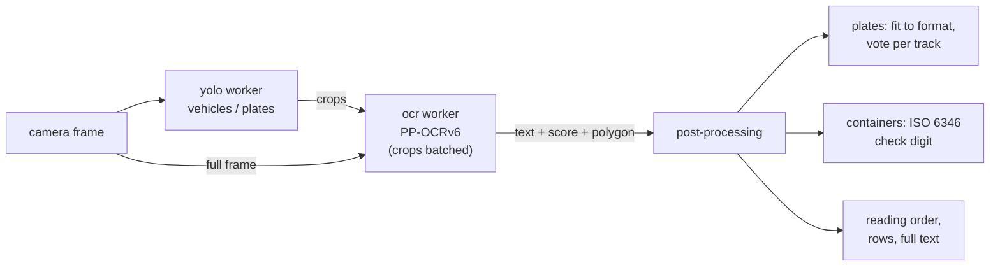

# maia-ocr

**Scene text, number plates and shipping-container codes for real-time video analytics.**
PP-OCRv6 models, served as an `ocr` worker on [maia-infer](https://github.com/jemaia-elwrose/maia-infer)
or run in-process, plus the post-processing that turns raw OCR into answers you can act on.



## Why the post-processing matters

OCR on camera footage is rarely clean: glare, motion blur, small text. A raw model reads
`MH12AB1Z34` or `C5QU 3O5438 3`. maia-ocr fixes what can be fixed and rejects what can't:

| Problem | What maia-ocr does |
|---|---|
| `0` / `O`, `8` / `B`, `5` / `S` confusions | Fits the text to a **plate format**: a position that must be a digit can't be `Z`, so it becomes `2`. Picks the reading needing the fewest changes, and refuses if too many are needed. |
| Different plate layouts | Formats are short templates (`"LL D{1,2} L{0,3} DDDD"`). Presets: `uae`, `india`, `uk`, `eu-de`, `generic`; pass your own for anything else. |
| UAE plates | `uae.parse` reads the layout, not just the string: the **number** is the tallest digit group, the **code** is the nearest letter(s) or 1-50 category number, and the **emirate** is matched from garbled small print (`SHARIAR`, `DU2HT`, `A.D` all work). Years, `U.A.E`, `COM`, `EXPORT` and Arabic-script noise are ignored. A code letter read as `0` comes back as `?` with candidates `D/O/Q` for the voter to settle. |
| Two-row and tilted plates | Rows are put in reading order and joined top row first; text more than 2x taller or shorter never shares a row, so a tilted plate's small print doesn't get mixed into the number. |
| A misread character in some frames | `PlateVoter` combines every reading of a tracked vehicle, position by position, weighted by confidence. |
| Container codes split over 2-3 lines | Lines are joined in reading order and searched for codes that start at a word boundary, so weight markings like `MAX.GR. 67.200 LB 30.480` can't pass the check digit by chance. |
| "Is this code real?" | ISO 6346 **check digit**: a misread character almost always breaks it, so only verified codes come out. |

## Backends

| Backend | Runtime | Models | Notes |
|---|---|---|---|
| `rapid` (default) | ONNX Runtime | PP-OCRv6 small, **bundled in the pip package** | CPU out of the box, `--opt device=cuda:0` with `onnxruntime-gpu`; nothing to download |
| `paddle` | PaddlePaddle | PP-OCRv6 medium (downloaded) | Most accurate, NVIDIA GPU; install `paddlepaddle-gpu` for your CUDA first, then `maia-ocr[paddle]` |

Both run PaddlePaddle's PP-OCR models (Apache-2.0), via [RapidOCR](https://github.com/RapidAI/RapidOCR)
and [PaddleOCR](https://github.com/PaddlePaddle/PaddleOCR) respectively. The document helpers in
PaddleOCR's default pipeline (page orientation, unwarping) are switched off: they cost time
and don't help on camera frames.

## Quick start

```bash
pip install "maia-ocr @ git+https://github.com/jemaia-elwrose/maia-ocr"

maia-ocr read sign.jpg --save sign_annotated.jpg     # all text, in reading order
maia-ocr plate plate.jpg --format uae                # fit to a plate format
maia-ocr container gate.jpg                          # verified ISO 6346 codes
```

As a service:

```bash
maia-infer broker &
maia-infer worker ocr --max-batch 16
```

```python
from maia_ocr import PlateVoter
from maia_ocr.client import OCRClient

ocr = OCRClient("tcp://localhost:5555")
lines = ocr.read(frame)  # TextLine(text, score, poly) in pixels
reading = ocr.read_plate(plate_crop, "uae")  # PlateReading(text, raw, valid, corrections, fields)
reading.fields  # {'emirate': 'Abu Dhabi', 'code': '14', 'number': '57319', 'key': '1457319', ...}

voter = PlateVoter(min_votes=3)  # '?' positions are filled by whichever frames read them
plate = voter.update(track_id, reading.fields["key"]) if reading.valid else voter.decision(track_id)
```

```python
from maia_ocr import containers, plates

plates.correct("MH12AB1Z34", "india")  # .text 'MH12AB1234', .valid True, .corrections 1
plates.correct("A8C 123", ["LLL DDD"])  # your own format -> 'ABC123'
containers.correct("C5QU 3O5438 3")  # 'CSQU3054383' (check digit verified)
containers.find(lines)  # every valid code in an OCR result
```

`examples/broker_test.py` checks the service through the broker (text, container codes,
a UAE plate, batching) and then reads any images you pass. `examples/plates_from_video.py`
puts it together on a traffic stream: YOLO vehicles, OCR, plate parsing and per-track voting.

```bash
maia-infer broker &  maia-infer worker ocr &
python examples/broker_test.py plate.jpg container.jpg --save out/
```

With Docker (CPU):

```bash
docker compose up --build
docker compose run --rm cli plate /data/plate.jpg --format uae     # ./data is mounted at /data
DATA_DIR=~/images docker compose run --rm cli plate /data/car.jpg --format uae  # or mount any folder
```

With Docker on an NVIDIA GPU (paddle backend; needs the NVIDIA Container Toolkit):

```bash
docker compose --profile gpu up --build broker ocr-gpu
docker compose --profile gpu run --rm ocr-gpu python -c "import paddle; paddle.utils.run_check()"  # GPU visible?
```

## Wire format

Request meta `{"mode": "read"}` (default) detects and reads every text line;
`{"mode": "recognize"}` treats the image as a single line, such as a plate crop, and all
recognize-mode crops in a batch are read in one call. The reply is
`arrays = [polygons (N, 4, 2), scores (N,)]` and `meta = {"texts": [...], "backend": ...}`.

## Plate formats are a starting point

The UAE parser is tested on real OCR output from real plates (Dubai, Abu Dhabi, Sharjah,
Ajman; private, commercial and export; numbers changed in the fixtures). What a parser
can't fix is text the OCR never returned: a small code printed beside the emirate name is
sometimes missed altogether, and then the plate comes back with `code=None`. Voting over a
track, a dedicated plate detector for tighter crops, or the paddle backend help there. The
template presets for other countries catch common layouts; for production, write the
templates for the plates your cameras actually see and test them on your footage.

## Project layout

```
src/maia_ocr/
  backends/      rapid (ONNX Runtime), paddle (PaddlePaddle)
  plates.py      formats, correction, two-row merge, PlateVoter
  uae.py         UAE plate layout: emirate, code, number
  containers.py  ISO 6346 validation, correction, search
  text.py        rows, reading order, full text
  workers.py     maia-infer worker: ocr
  client.py      OCRClient for pipelines
  cli.py         maia-ocr read | plate | container
examples/        broker test, number plates from a traffic stream
```

## Development

```bash
pip install -e ".[dev]"
pytest -q          # 46 tests, ~15 s; includes real OCR with the bundled models
ruff check . && ruff format --check .
```

## License

MIT for this code. PP-OCR models and RapidOCR / PaddleOCR are Apache-2.0.
